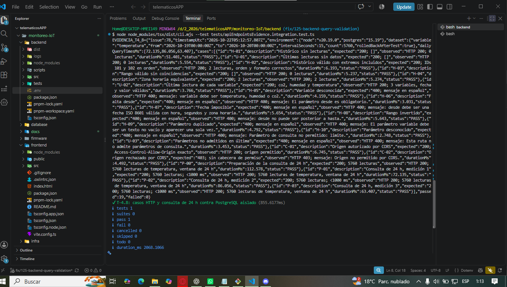

# Verificación de la validación de consultas (#125)

## Contexto

La validación de #75 ya está integrada en feature/backend-mqtt-api mediante el PR #121. Esta evidencia verifica la corrección solicitada en #125 y conserva el informe histórico de #78 sin modificarlo.

Commit verificado: `c4fc87b9c8c29a5e29dc317348e5b06550e60f5c` (base de la rama `fix/125-backend-query-validation`).

Ejecución UTC: `10/22/2026 05:11:43`. Entorno local: Node.js `v20.19.0` y PostgreSQL `15.19`.

## Método

Se ejecutó la aplicación Express real mediante solicitudes HTTP y PostgreSQL real. Los datos sintéticos se crean dentro de una transacción aislada y se revierten al finalizar. No se requiere iniciar MQTT ni el dashboard para esta prueba.

Desde `backend/`, con PostgreSQL disponible y las variables PG_* en el archivo local .env:

```bash
node node_modules/tsx/dist/cli.mjs --test tests/apiEndpointsEvidence.integration.test.ts
```

El informe completo, sin credenciales, está en [resultados.json](resultados.json). Es salida estructurada de la prueba, no una captura de pantalla.

## Resultados

**19 de 19 casos aprobados; 0 fallidos.**

| ID | Caso | Esperado | Observado | Tiempo (ms) | Resultado |
|---|---|---|---|---:|---|
| H-01 | Histórico sin lecturas | 200; [] | HTTP 200; 0 lecturas | 72.879 | Aprobado |
| U-01 | Últimas lecturas sin datos | 200; [] | HTTP 200; 0 lecturas | 5.093 | Aprobado |
| H-02 | Histórico válido con extremos incluidos | 200; IDs 101 y 102 en orden | HTTP 200; 2 lecturas, orden y formato correctos | 6.242 | Aprobado |
| H-03 | Rango válido sin coincidencias | 200; [] | HTTP 200; 0 lecturas | 4.876 | Aprobado |
| H-04 | Zona horaria equivalente | 200; 2 lecturas | HTTP 200; 2 lecturas | 5.436 | Aprobado |
| U-02 | Última lectura de cada variable | 200; co2, humedad y temperatura | HTTP 200; 3 variables, fecha y valor válidos | 5.259 | Aprobado |
| H-05 | Variable desconocida | 400; mensaje en español | HTTP 400; mensaje: variable debe ser temperatura, humedad o co2. | 4.292 | Aprobado |
| H-06 | Falta desde | 400; mensaje en español | HTTP 400; mensaje: El parámetro desde es obligatorio. | 3.941 | Aprobado |
| H-07 | Fecha imposible | 400; mensaje en español | HTTP 400; mensaje: desde debe ser una fecha ISO 8601 válida con hora, segundos y zona horaria. | 4.257 | Aprobado |
| H-08 | Rango invertido | 400; mensaje en español | HTTP 400; mensaje: desde no puede ser posterior a hasta. | 4.842 | Aprobado |
| H-09 | Parámetro duplicado | 400; mensaje en español | HTTP 400; mensaje: El parámetro variable debe ser un texto no vacío y aparecer una sola vez. | 5.188 | Aprobado |
| H-10 | Parámetro desconocido | 400; mensaje en español | HTTP 400; mensaje: Parámetro de consulta no permitido: limite. | 3.384 | Aprobado |
| U-03 | Parámetros no admitidos en última | 400; mensaje en español | HTTP 400; mensaje: Esta ruta no admite parámetros de consulta. | 2.997 | Aprobado |
| C-01 | Origen autorizado por CORS | 200; Access-Control-Allow-Origin exacto | HTTP 200; origen permitido | 7.235 | Aprobado |
| C-02 | Origen rechazado por CORS | 403; sin cabecera de permiso | HTTP 403; mensaje: Origen no permitido por CORS. | 4.876 | Aprobado |
| P-00 | Preparación de la consulta de 24 h | 200; 5760 lecturas | HTTP 200; 5760 lecturas de temperatura, ventana de 24 h | 113.276 | Aprobado |
| P-01 | Consulta de 24 h, medición 1 | 200; 5760 lecturas; <1000 ms | HTTP 200; 5760 lecturas de temperatura, ventana de 24 h | 72.746 | Aprobado |
| P-02 | Consulta de 24 h, medición 2 | 200; 5760 lecturas; <1000 ms | HTTP 200; 5760 lecturas de temperatura, ventana de 24 h | 70.496 | Aprobado |
| P-03 | Consulta de 24 h, medición 3 | 200; 5760 lecturas; <1000 ms | HTTP 200; 5760 lecturas de temperatura, ventana de 24 h | 74.189 | Aprobado |

## Comprobaciones

- H-05: variable desconocida responde 400 con mensaje claro.
- H-07: fecha imposible responde 400; las pruebas unitarias verifican que no se consulta PostgreSQL con ese dato.
- H-08: rango invertido responde 400.
- Los tres tiempos de consulta de 24 horas están por debajo de 1000 ms, con 5760 lecturas.
- Se mantiene el manejo central de errores de #77: la suite automatizada comprueba respuestas 500 uniformes sin detalles internos.
- Verificación adicional realizada: npm run build correcto y npm test con 101 pruebas aprobadas.

Este PR aporta evidencia de una corrección ya integrada; no agrega otra implementación ni cambia el README general.

## Captura de ejecución manual

Captura real enviada por Rodrigo de una ejecución adicional del mismo comando.
La salida JSON muestra `passed: 19` y `failed: 0`. El resumen `tests 1`
corresponde al único test que agrupa los 19 casos HTTP, no a un solo caso.
Los tiempos pueden variar entre esta ejecución y la del archivo resultados.json.


