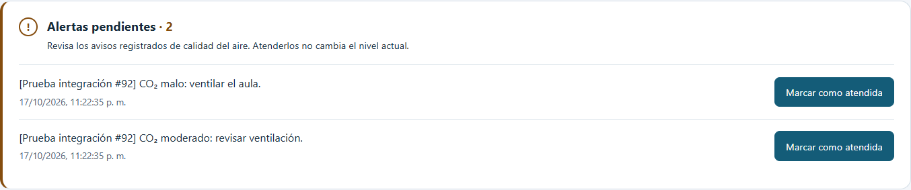
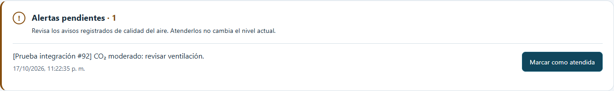
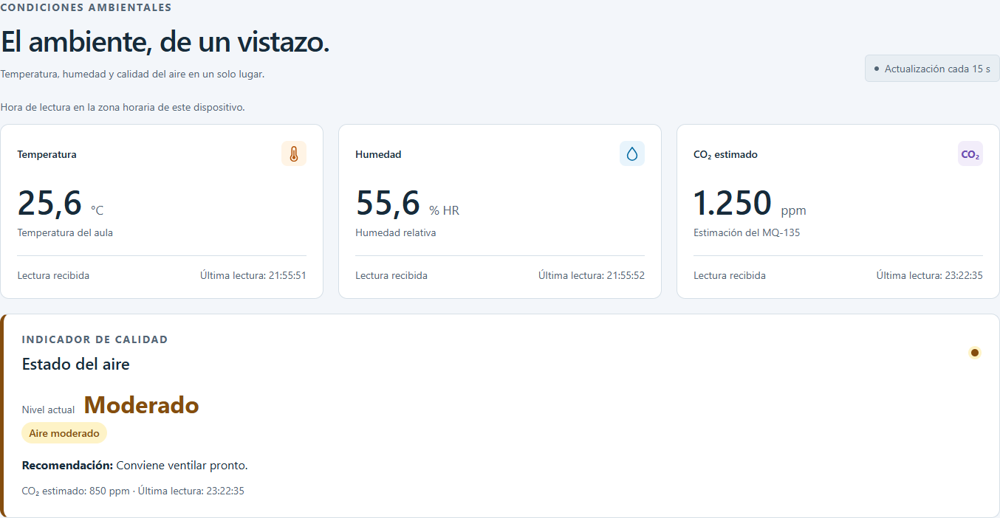

# Aviso de alertas pendientes — #92

Se incorporan capturas en lugar del video a solicitud del responsable.
Capturas reales de Microsoft Edge obtenidas con Playwright sobre el dashboard
de `feat/92-alert-banner`, en una ventana de 1440 × 1000 píxeles.

## Integración con backend y PostgreSQL reales

Prueba completada con el backend Express del repositorio en
`http://localhost:3000`, el frontend en `http://localhost:5193` y la base local
`monitoreo_ambiental` de PostgreSQL, con el rol `app`. No se interceptaron
peticiones ni se simularon respuestas en esta ejecución. No se necesitan
sensores para comprobar la atención de alertas.

La base solo tenía `lecturas`; se aplicó `database/esquema.sql` para completar
las tablas y vistas del proyecto, conservando las lecturas existentes.
Se insertaron dos lecturas y dos alertas identificadas con
`[Prueba integración #92]`, utilizando IDs explícitos sin consumir secuencias.
Los datos son sintéticos; la API y la persistencia son reales.

### Aviso inicial

### Primera alerta atendida

El primer PATCH respondió HTTP 200 y la interfaz conservó únicamente la otra
alerta pendiente.

### Última alerta atendida y página recargada

Los dos PATCH enviaron `{"atendida":true}`. Una consulta SQL independiente
confirmó `atendida = true` en ambas filas. Después de recargar la página,
`GET /api/alertas?atendida=false` devolvió `[]`, el aviso siguió ausente y una
nueva consulta SQL confirmó que los valores persistían.

El [registro de integración real](alertas-92-integracion-real.json) incluye
fecha, conexión sin credenciales, peticiones y respuestas reales, consultas
antes y después, y resultado de la limpieza. Al terminar se eliminaron
únicamente las lecturas de prueba y sus alertas asociadas; se conservó la
cantidad original de lecturas. Las tablas y vistas del esquema permanecen.

- [x] Aviso visible mientras existen alertas pendientes.
- [x] Botones ejecutan PATCH real y reciben HTTP 200.
- [x] Al atender todas, desaparece el aviso.
- [x] Atención persistida en PostgreSQL y conservada después de recargar.

## Verificación adicional de la implementación

- `pnpm test`: 34 pruebas aprobadas, incluidos los casos de atención,
  actualización periódica, error y respuestas antiguas.
- `pnpm lint`: sin errores ni advertencias.
- `pnpm build`: correcto; repetido después del ajuste de colores globales.
- Revisión anterior en Edge de escritorio y móvil: sin desbordamiento
  horizontal a 390 píxeles y con reintento tras un PATCH fallido.
