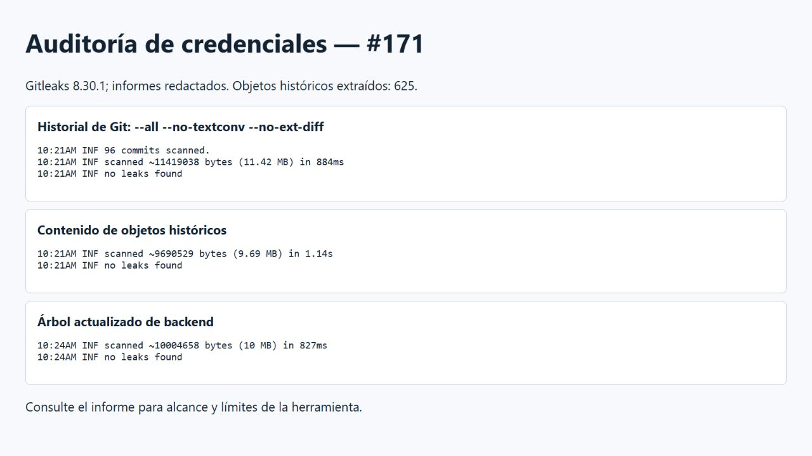

# Auditoría de credenciales — #135

El 28/10/2026 se actualizaron las referencias remotas y se examinaron los
187 commits alcanzables y 619 objetos de contenido del historial. La búsqueda
se ejecutó en local con `backend/scripts/secretsAudit.py`: compara credenciales
privadas actuales sin imprimirlas, detecta algunos formatos conocidos de claves
privadas, tokens de GitHub, claves AWS y JWT, y señala asignaciones sospechosas.
Los informes de objetos y etiquetas quedan en `backend/logs/`, ignorado por Git.


- Los cuatro patrones de tokens y claves no dieron coincidencias.
- Se revisaron 18 candidatos por asignación: corresponden a referencias a
  variables, rutas o valores de prueba en pruebas automatizadas.
- Se compararon seis valores privados locales; hubo 16 coincidencias textuales
  de un valor WiFi en documentos, sin asignaciones de contraseña en esas líneas.
  El resto de valores privados comparados no apareció en los objetos.
- `git check-ignore` confirmó la exclusión de `.env`, `backend/.env`,
  `frontend/.env`, `firmware/include/config.h`, `firmware/include/secrets.h`
  y `infra/mosquitto/passwd`. Se añadió la regla para `secrets.h`.

En la primera ejecución, la descarga de Gitleaks no se completó. La
búsqueda aplicada cubre los formatos y valores descritos, no garantiza detectar
credenciales de otros formatos ni determina por sí sola si un valor desconocido
sigue vigente. No se encontró una credencial vigente en los candidatos revisados.
No se publican los valores privados ni los informes locales detallados.

## Repetir

Desde la raíz, con Python y Git disponibles, ejecutar:

```powershell
python backend/scripts/secretsAudit.py
```

Si se ejecuta desde un worktree sin archivos privados, establecer
`AUDIT_PRIVATE_ROOT` en la raíz de la copia que los contiene. No compartir ese
informe ni las variables de entorno. Las coincidencias deben revisarse en contexto
antes de determinar si representan una credencial y si requiere rotación.
## Ampliación con Gitleaks — #171

El 28/10/2026 se descargó Gitleaks 8.30.1 de su publicación oficial y se
verificó el SHA-256 del archivo contra el fichero de sumas de esa publicación.
Se actualizaron las ramas y etiquetas remotas antes del análisis.

1. `gitleaks git --log-opts="--all --no-textconv --no-ext-diff" --redact=100`
   examinó los parches accesibles e informó **96 commits con salida examinada**
   y **0 hallazgos**. Git tenía 190 commits alcanzables; no se interpreta el
   contador de Gitleaks como si hubiera informado 190.
2. Para cubrir contenido de objetos también presentes en fusiones, se
   extrajeron los **625 blobs únicos** de `git rev-list --objects --all` a una
   carpeta local temporal y se analizaron con `gitleaks dir --redact=100`:
   **0 hallazgos**. Se conservó el nombre de cada archivo, pero no su ruta
   original completa; algunas reglas dependientes de la ruta pueden diferir.
3. El árbol actualizado de `feature/backend-mqtt-api` se analizó por separado
   con `gitleaks dir --redact=100`: **0 hallazgos**.
4. Se comprobó con un broker aislado que las claves locales de `esp32` y
   `backend` son distintas, tienen al menos 12 caracteres y autentican ambos
   clientes de prueba. La conexión física del ESP32 quedó documentada en #133.
5. `API_KEY` está vacío en la plantilla raíz de backend y `VITE_API_KEY` está
   vacío en la plantilla de la rama frontend; el README explica ambas claves.



La imagen muestra los registros reales sin valores privados. Los informes y
objetos extraídos se conservaron únicamente en la máquina local, fuera del repo.
Gitleaks busca patrones conocidos y puede omitir secretos en formatos no
reconocidos, imágenes o archivos binarios; un resultado sin hallazgos no es una
garantía matemática de ausencia de credenciales. No se detectaron credenciales
reales en el alcance analizado. Ante un hallazgo futuro, rotar la credencial.

### Actualización posterior a la interrupción de red

Al recuperar la conexión se actualizaron nuevamente las referencias. Git
reportó 193 commits alcanzables y se extrajeron 634 blobs únicos. Gitleaks
informó 99 commits con salida examinada y 0 hallazgos en los parches; el
análisis de los 634 objetos también informó 0 hallazgos. La captura anterior
corresponde a la ejecución inicial de 625 objetos, conservada como evidencia.
