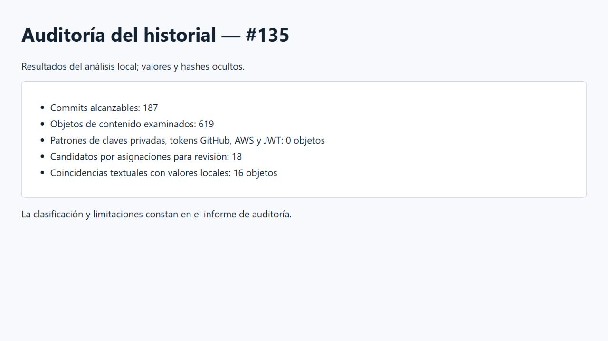

# Auditoría de credenciales — #135

El 28/10/2026 se actualizaron las referencias remotas y se examinaron los
187 commits alcanzables y 619 objetos de contenido del historial. La búsqueda
se ejecutó en local con `backend/scripts/secretsAudit.py`: compara credenciales
privadas actuales sin imprimirlas, detecta algunos formatos conocidos de claves
privadas, tokens de GitHub, claves AWS y JWT, y señala asignaciones sospechosas.
Los informes de objetos y etiquetas quedan en `backend/logs/`, ignorado por Git.



- Los cuatro patrones de tokens y claves no dieron coincidencias.
- Se revisaron 18 candidatos por asignación: corresponden a referencias a
  variables, rutas o valores de prueba en pruebas automatizadas.
- Se compararon seis valores privados locales; hubo 16 coincidencias textuales
  de un valor WiFi en documentos, sin asignaciones de contraseña en esas líneas.
  El resto de valores privados comparados no apareció en los objetos.
- `git check-ignore` confirmó la exclusión de `.env`, `backend/.env`,
  `frontend/.env`, `firmware/include/config.h`, `firmware/include/secrets.h`
  y `infra/mosquitto/passwd`. Se añadió la regla para `secrets.h`.

La descarga del ejecutable oficial de Gitleaks no se completó en esta red. La
búsqueda aplicada cubre los formatos y valores descritos, no garantiza detectar
credenciales de otros formatos ni determina por sí sola si un valor desconocido
sigue vigente. No se encontró una credencial vigente en los candidatos revisados.
No se publican los valores privados ni los informes locales detallados.

## Repetir

Desde la raíz, con Python y Git disponibles, ejecutar:

```powershell
python backend/scripts/secretsAudit.py
```

Si se ejecuta desde un worktree sin archivos privados, establecer
`AUDIT_PRIVATE_ROOT` en la raíz de la copia que los contiene. No compartir ese
informe ni las variables de entorno. Las coincidencias deben revisarse en contexto
antes de determinar si representan una credencial y si requiere rotación.