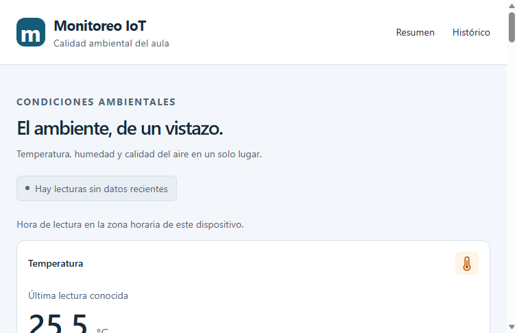
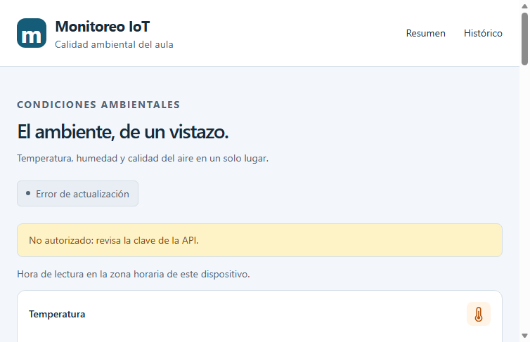

# Evidencia de la clave del dashboard - #132

Se ejecutó `node tests/api-key.browser.mjs` desde `frontend/`, con Edge y la API
local real protegida por #157. Se usaron los valores privados de `frontend/.env`.
Las capturas no muestran claves ni encabezados sensibles.

| Caso | Resultado |
|---|---|
| Clave configurada correcta | Se muestran las lecturas de la API local |
| Clave sustituida por una incorrecta en el transporte | Mensaje «No autorizado: revisa la clave de la API.» |
| Encabezado retirado en el transporte | Mismo mensaje claro; la interfaz permanece visible |

El comprobador registró 24 solicitudes y verificó que el cliente genera el
encabezado en todas. Solo el interceptor de pruebas lo sustituye o retira para
los casos negativos. `resultados.json` conserva rutas y presencia del encabezado,
nunca su valor. Las 48 pruebas unitarias, lint, build y las suites de navegador
de históricos y estados también pasaron.

