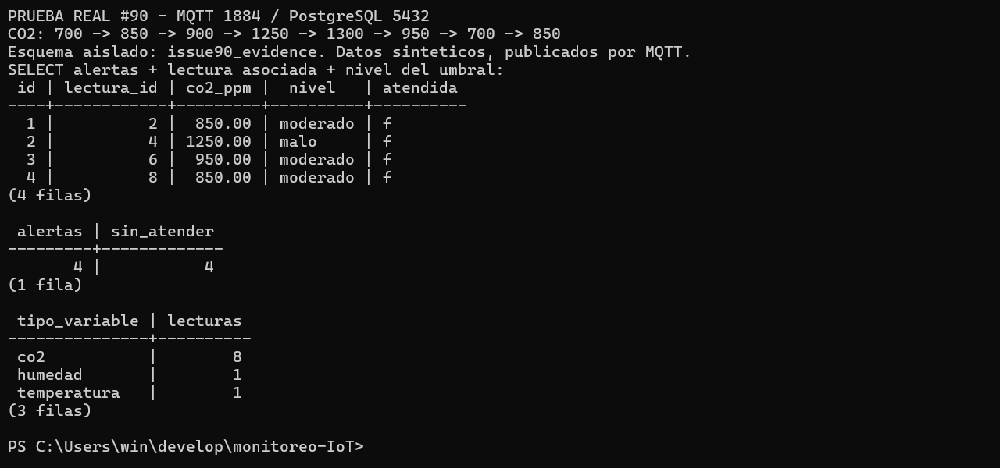

# Generación de alertas de CO₂ — #90

Rama: `feat/90-co2-alert-generation`. Destino: `feature/backend-mqtt-api`.
Dependencia: #88. Los rangos siguen siendo provisionales hasta revisión del PO.

## Implementación

`insertReading()` deriva las lecturas de CO₂ a `co2AlertService.ts`.
La lectura y su posible alerta se guardan en una transacción con un único
cliente PostgreSQL. Un bloqueo transaccional (`pg_advisory_xact_lock(90, 1)`)
serializa el procesamiento de CO₂ entre conexiones y procesos del backend.
Se usa READ COMMITTED para consultar el estado confirmado tras obtener el bloqueo.

Se consulta la última lectura de CO₂ persistida (`id DESC`) y se clasifican
su valor y el nuevo con los umbrales actuales de `umbrales`, ordenados por
`valor_desde DESC`. No se codifican los límites en TypeScript. Se compara el
valor devuelto por PostgreSQL para respetar el redondeo de `NUMERIC(8,2)`.

- Entrar a moderado o malo crea una alerta; permanecer en el nivel no.
- Malo → moderado también alerta. Volver a bueno no alerta, pero permite
  detectar una entrada posterior a moderado/malo.
- La primera lectura moderada o mala alerta como primera detección.
- El estado se obtiene de la base, no de memoria: reiniciar no lo pierde.
- Cada alerta referencia la lectura y el umbral y se crea con `atendida=false`.
- Sin umbral aplicable se guarda la lectura sin inventar una clasificación.
- Temperatura y humedad conservan su guardado habitual, sin generar alertas.
- Si falla una operación de la transacción, se revierte lectura y alerta.
  El error llega al suscriptor, que lo registra y continúa con otros mensajes.

Las transiciones siguen el orden de persistencia. No se reconstruye una
cronología de alertas por inserciones históricas manuales ni se generan
alertas desde los endpoints de consulta.

## Verificaciones ejecutadas

El 16 de octubre de 2026:

| Verificación | Resultado |
|---|---|
| `pnpm install --frozen-lockfile` | Aprobado |
| `pnpm test` | 57 pruebas aprobadas |
| `pnpm typecheck` | Aprobado |
| `pnpm build` | Aprobado |
| `pnpm test:integration:alerts` | 6 comprobaciones aprobadas (incluye prueba contenedora) |
| `pnpm test:integration:latest` | 4 comprobaciones aprobadas |
| `pnpm test:integration:history` | 7 comprobaciones aprobadas |

La integración usa PostgreSQL real en un esquema aislado y lo elimina al
terminar. Comprueba transiciones, primera detección, 12 escrituras concurrentes,
otra instancia de conexión, umbrales editables, redondeo y rollback ante un
fallo deliberado de inserción de alerta, seguido de otro guardado correcto.
Las pruebas existentes verifican que el suscriptor continúa tras fallos.

## Evidencia MQTT real

Ejecución: **2026-10-16T19:05:03.840Z**. Datos sintéticos, no mediciones del ESP32.

- PostgreSQL: `monitoreo_ambiental`, usuario `app`, puerto **5432**.
- Mosquitto 2.1.2: **127.0.0.1:1884**, autenticación y ACL del repositorio.
- Backend compilado: **3090**, HTTP 200 y suscripción a `ambiente/#`.
- `PGOPTIONS=-c search_path=issue90_evidence` solo en el proceso de prueba.
- Se cargó `database/esquema.sql` en ese esquema aislado sin modificarlo.
- Publicación como `esp32`, QoS 0, sin retain; se esperó cada inserción para
  verificar las transiciones en el orden indicado.

| Lectura CO₂ | Valor | Nivel | Alerta |
|---:|---:|---|---|
| 1 | 700 | bueno | No |
| 2 | 850 | moderado | Sí |
| 3 | 900 | moderado | No |
| 4 | 1250 | malo | Sí |
| 5 | 1300 | malo | No |
| 6 | 950 | moderado | Sí |
| 7 | 700 | bueno | No |
| 8 | 850 | moderado | Sí |

También se publicaron temperatura `24.5` y humedad `55`: ambas se guardaron
sin nuevas alertas. Se descartaron `abc` en `ambiente/co2`, `1` en
`ambiente/status` y `1013` en `ambiente/presion`.

**Resultado:** 13 publicaciones/recepciones, 3 descartes, 10 lecturas guardadas
(8 de CO₂) y **4 alertas**, todas con `atendida=false`, ligadas a las lecturas
2, 4, 6 y 8. Las alertas contienen los valores 850, 1250, 950 y 850 ppm.

Captura real de PowerShell ejecutando psql, recortada a los resultados.
Consultas de verificación: `database/verify_co2_alerts.sql`.
Tras la captura se detuvo el backend de prueba y se eliminó el esquema
`issue90_evidence`; el histórico habitual se conservó.

## Reproducción

1. Configurar las conexiones locales del backend y ejecutar las verificaciones
   de la tabla anterior desde `backend/`.
2. Para la prueba manual, preparar un esquema vacío de prueba y cargar allí
   `database/esquema.sql`. Usar `PGOPTIONS=-c search_path=<esquema>` en las
   terminales del backend y de psql para no alterar el histórico habitual.
3. Iniciar un broker con autenticación y el ACL del proyecto y una única
   instancia del backend. Configurar `MQTT_URL` con el puerto elegido.
4. Publicar los ocho valores de la tabla con `mosquitto_pub` como `esp32`,
   topic `ambiente/co2`, QoS 0 y sin `-r`. Esperar el guardado de cada lectura.
5. Publicar las dos lecturas adicionales y los tres descartes descritos.
6. Ejecutar `database/verify_co2_alerts.sql` en ese esquema y comprobar las
   cuatro alertas sin atender; capturar las filas sin mostrar credenciales.
7. Detener los procesos de prueba y eliminar únicamente el esquema creado.

## Criterios de aceptación

- [x] Pasar a moderado o malo inserta una alerta.
- [x] No se repite una alerta mientras el nivel no cambie.
- [x] La alerta nueva queda sin atender.
