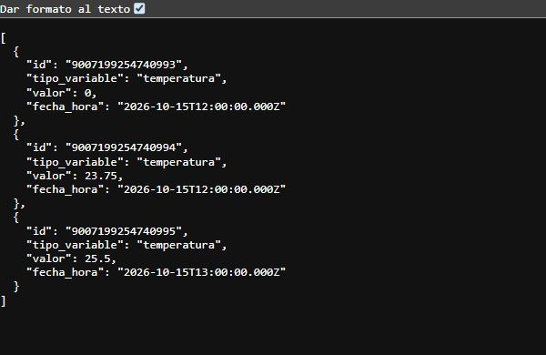

# Histórico con filtros: evidencia de #74

Verificación del 16 de octubre de 2026. Contrato: sección 3 de
[api.md](../api.md). Dependencias: #73 y #27.

## Criterios de aceptación

| Criterio | Comprobación |
|---|---|
| Lecturas de una variable dentro del rango y ordenadas por fecha | HTTP con PostgreSQL real: extremos inclusivos, datos fuera de orden, exclusión de otras variables y desempate por `id ASC`. |
| Consulta parametrizada | `$1`, `$2` y `$3`, con valores enviados aparte al pool. Prueba adicional con un valor que contiene SQL. |
| Separación de capas | `historicalReadingRoutes.ts`, `historicalReadingController.ts` y `historicalReadingService.ts`. |
| Sin coincidencias | HTTP 200 con `[]`, tanto con tabla vacía como con lecturas fuera del rango. |

## Captura real

Solicitud ejecutada contra el backend compilado, con HTTP 200:

```http
GET http://127.0.0.1:3074/api/lecturas?variable=temperatura&desde=2026-10-15T12:00:00Z&hasta=2026-10-15T13:00:00Z
```



La captura usa siete lecturas sintéticas, no mediciones del ESP32. Se cargó
`database/esquema.sql` sin cambios en un esquema separado y se inició el backend
con `API_PORT=3074` y `PGOPTIONS=-c search_path=<esquema_de_prueba>` solo en su proceso.
Después se detuvo el proceso y se eliminó ese esquema, conservando los datos habituales.

## Reproducción

Desde `backend/`, con las variables PostgreSQL de `backend/.env`:

```powershell
pnpm install --frozen-lockfile
pnpm test
pnpm run test:integration:history
pnpm run test:integration:latest
pnpm typecheck
pnpm build
```

Resultados tras incorporar #76: 41 pruebas del backend, 7 comprobaciones de
integración del histórico y 4 de últimas lecturas aprobadas; tipos y compilación
sin errores. Las integraciones ejecutan `ROLLBACK` al terminar.
Comprueba las tres variables, offsets equivalentes, rango puntual, cero, decimales,
BIGINT como string y 5761 filas sin truncamiento. No mide el rendimiento de #78.

Se comprueban presencia, valores escalares no vacíos, parámetros repetidos/adicionales
y ausencia de cuerpo GET. La validación semántica completa (variable conocida,
ISO 8601 estricto y rango invertido) queda pendiente de #75. La HU-04 requiere
esa tarea para completar los casos 400 del contrato; esta PR no cierra #75.
