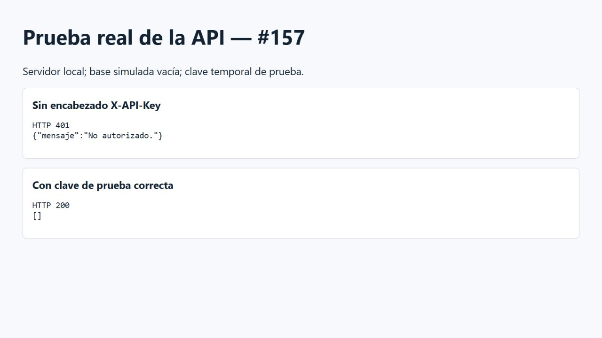

# Evidencia de autenticación de la API — #157

La captura muestra respuestas HTTP reales de la aplicación local: sin encabezado,
401; con una clave temporal de prueba, 200. Se sustituyó la consulta a la base
por una respuesta vacía controlada; la captura no contiene claves reales.

La suite automatizada también comprueba la clave incorrecta, la protección de
lecturas, histórico, estado del aire y alertas, el preflight CORS y el rechazo
al arrancar sin API_KEY. Resultado: 103 pruebas aprobadas.