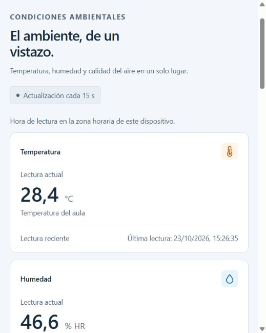
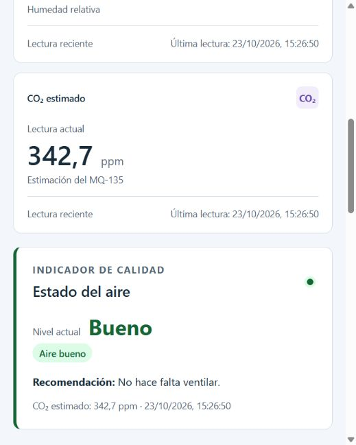
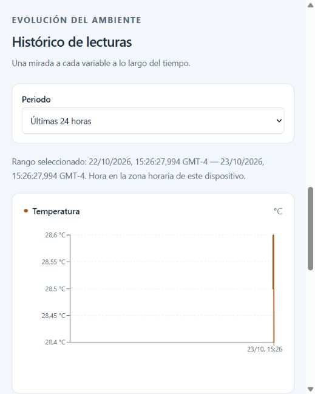

# Prueba física de integración del Sprint 2

Issue: #94. Ejecución del 23/10/2026.

## Alcance y duración

Cadena física ESP32 → Mosquitto → backend → PostgreSQL local → API → dashboard. Inicio: 2026-10-23T19:23:44.842Z. Fin: 2026-10-23T19:40:37.7862036Z. Duración registrada: **16 min 52.9 s**. El equipo comunicó el 23/10/2026 una reducción de alcance: se acepta la validación funcional durante la ventana observada y se sustituye el objetivo inicial de 30 minutos. Los registros y las duraciones medidas se conservan sin alteraciones.

El firmware usado fue el entorno físico esp32dev, con DHT22 y MQ-135. La referencia de CO2 sigue siendo provisional; la calibración con 50 lecturas exteriores pertenece al Sprint 3. El destino MQTT se ajustó solo en config.h privado a la IP actual del hotspot.

## Resultados observados

| Variable | Mensajes recibidos por MQTT | Filas coincidentes en PostgreSQL | Mayor intervalo (s) |
|---|---:|---:|---:|
| temperatura | 68 | 68 | 15.114 |
| humedad | 68 | 68 | 16.121 |
| co2 | 68 | 68 | 16.122 |

El monitor independiente registró **67 comprobaciones HTTP**; todas coincidieron con PostgreSQL y tuvieron datos recientes. Fallos de API registrados: 0. Eventos de desconexión MQTT registrados: 0. Mensajes del log sin fila equivalente: 0. La comparación usa variable, valor y proximidad temporal, sin reutilizar filas.

## Evidencia visual

Las imágenes son capturas directas del dashboard durante la publicación física. El video es una secuencia de 64 capturas reales a 2 por segundo (32 s nominales), tomada entre 19:27:25 y 19:27:58 UTC. Los PNG se codificaron desde las capturas del navegador sin reconstruir ni cambiar los valores.

El archivo t7-1/evidencia-integracion-fisica.zip contiene el video, los mensajes recibidos y el resultado JSON con el checkpoint del monitor. Los campos requiredDurationSeconds, fullDurationCompleted y targetSeconds conservan el objetivo original de 1 800 s y su resultado; el cambio de alcance está documentado en #94.

## Verificaciones complementarias

- Backend: compilación correcta y 101 pruebas aprobadas.
- Frontend: compilación correcta y 46 pruebas aprobadas.
- Alertas con PostgreSQL real en esquema aislado: cinco escenarios aprobados.
- Casos de #78: 19 aprobados; 5 760 lecturas en 27,747; 28,319 y 35,792 ms.
- Cliente MQTT anónimo: rechazado con not authorised y salida 5.
- El filtro del histórico mostró las tres variables y las tarjetas actualizaron fechas y valores cada 15 s.

## Cómo repetir la prueba

1. Iniciar PostgreSQL local, Mosquitto con infra/mosquitto/mosquitto.conf y el backend de su rama de área.
2. Conectar PC y ESP32 al mismo hotspot de 2,4 GHz; comprobar que mqtt_host del config.h privado coincide con la IPv4 de la PC.
3. Cargar el entorno físico esp32dev y esperar calentamiento, referencia provisional y publicaciones en ambiente/# cada 15 s.
4. Abrir el dashboard en http://localhost:5173; comparar API /api/lecturas/ultima con v_ultima_lectura y los mensajes MQTT.
5. Registrar inicio, fin, duración, mensajes recibidos, filas coincidentes y comprobaciones de API; adjuntar el registro de la ventana observada.

## Versiones de origen

- Backend: a8d83dcbc9d876dce6209ee7b9203db5208d730a.
- Frontend: c71f367d4355c4fbace9edb7c3d188bab3c8405f.
- Firmware: fb7fbcd93b152116c8e439c5eb590c5ad49056e5.
