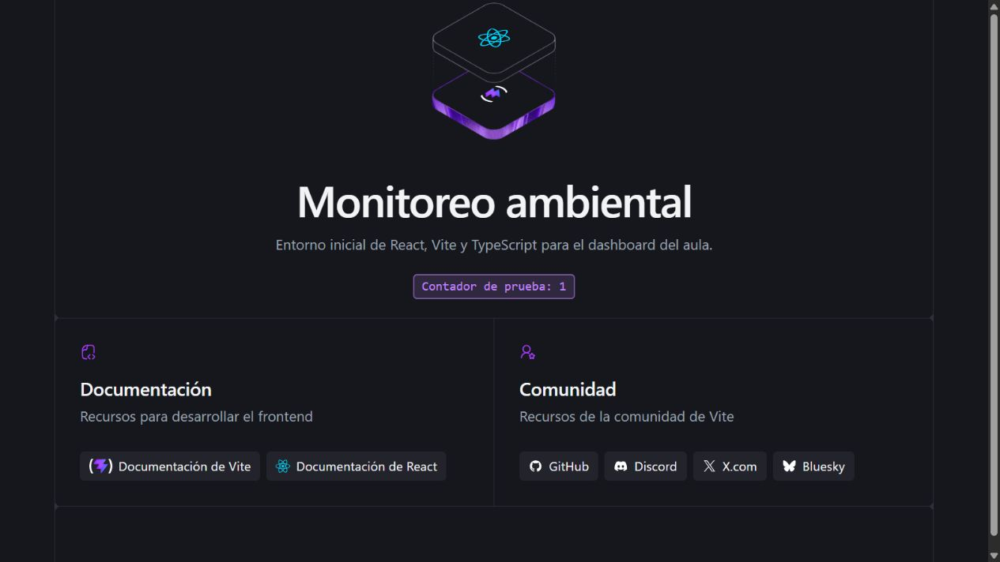

# T-5.1 — Proyecto React + Vite + TypeScript con Recharts

Issue: #80. Rama: `chore/80-react-vite-setup`.
Base y destino de la PR: `feature/frontend-dashboard`.

## Cambio

Se conservó el proyecto existente de React + Vite + TypeScript en `frontend/`
y se agregó Recharts con su actualización de `pnpm-lock.yaml`.
Se añadieron `.env.example`, la exclusión de archivos `.env` y la guía de
instalación y arranque en `frontend/README.md`. La pantalla inicial y el título
del documento se adaptaron al español.

El archivo privado `frontend/.env` se creó localmente con
`VITE_API_URL=http://localhost:3000`; no se versiona. La plantilla pública
contiene la misma dirección de ejemplo, sin contraseñas ni tokens.

## Verificación ejecutada

Entorno local: Windows, Node.js 24.20.0 y pnpm 10.34.7.

| Comprobación | Resultado |
|---|---|
| `npm run lint` desde `frontend/` | Código de salida 0 |
| `npm run build` desde `frontend/` | TypeScript y Vite completados, código de salida 0 |
| `pnpm list recharts --depth 0` | Recharts 3.10.1, dependencia de producción |
| `npm run dev -- --host 127.0.0.1 --port 5173 --strictPort` | Vite 8.3.2 iniciado en 448 ms |
| Navegador en `http://127.0.0.1:5173/` | Pantalla inicial visible |
| Clic en el contador de prueba | Estado React actualizado de 0 a 1 |
| `git check-ignore frontend/.env` | Archivo privado excluido |

## Criterios de aceptación

- [x] El proyecto está en `frontend/` y arranca con `npm run dev`.
- [x] Recharts está instalado.
- [x] `VITE_API_URL` está en el `.env` local, existe `.env.example` público y
      `.gitignore` excluye `.env` y sus variantes privadas.
- [x] Captura del proyecto corriendo adjunta.

La captura procede del navegador con el servidor de desarrollo real y muestra
el contador después del clic. No contiene credenciales ni valores ambientales.
Esta tarea prepara el entorno: el cliente API, layout, tarjetas y gráficos
se implementarán en las tareas siguientes de HU-05.
