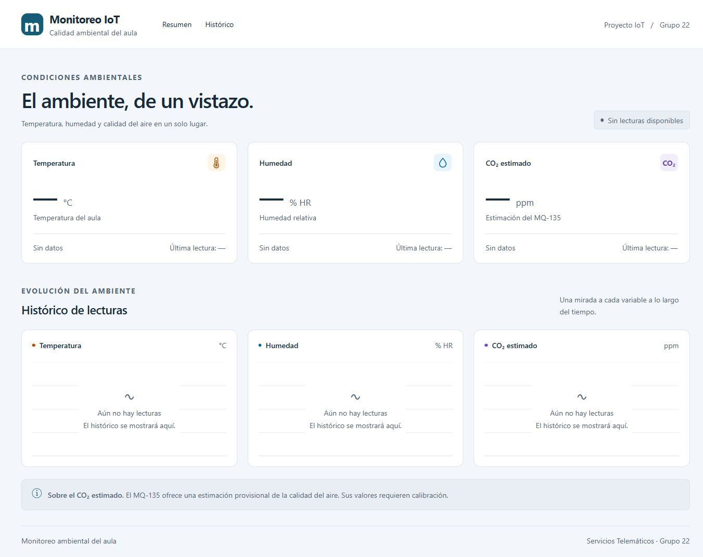
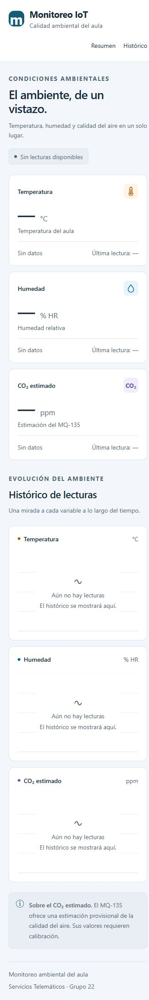

# T-5.3 — Layout adaptable del dashboard

Issue: #82. Rama: `feat/82-dashboard-layout`.
Base y destino de PR: `feature/frontend-dashboard`.
Dependencia #80 integrada mediante PR #102.

## Resultado

Se reemplaza la pantalla inicial de Vite por la estructura del dashboard:

- Encabezado con identidad del proyecto y navegación a Resumen e Histórico.
- Tres tarjetas para temperatura, humedad y CO2 estimado, con sus unidades.
- Tres áreas reservadas al histórico de cada variable.
- Nota sobre el carácter provisional de la estimación de CO2 y pie del proyecto.
- Navegación semántica, encabezados y enlace para saltar al contenido.
- Identidad «Monitoreo IoT», coherente con el repositorio, y textos auxiliares
  de al menos 14 px para mejorar la lectura.
- Ancho fluido sin límite central de 1240 px: márgenes laterales entre 24 y
  64 px en escritorio, y 20 px en celular. Las tarjetas crecen con la pantalla.

Esta tarea es de maquetación. Las tarjetas no consultan la API ni se actualizan
todavía: usan guiones y el texto «Sin datos». Los históricos son estados vacíos,
no gráficos con mediciones inventadas. Las tarjetas dinámicas corresponden a
#83 y los gráficos Recharts a #84.

## Criterios de aceptación

- [x] Encabezado, zona de tarjetas y área de gráficos presentes.
- [x] Adaptación a laptop y celular desde 360 px.
- [x] Sin desplazamiento horizontal en 360 px.
- [x] Capturas de laptop y celular incluidas.

## Comprobaciones ejecutadas

Servidor iniciado con `npm run dev -- --host 127.0.0.1 --port 5173 --strictPort`.
Verificación en navegador Chromium mediante dimensiones de viewport, sin
ocultar el desbordamiento horizontal por CSS.

| Viewport solicitado | Ancho disponible | Ancho del documento | Scroll horizontal | Columnas de tarjetas |
|---|---:|---:|---|---:|
| 320 px | 305 px | 305 px | No | 1 |
| 360 px | 345 px | 345 px | No | 1 |
| 390 px | 375 px | 375 px | No | 1 |
| 620 px | 605 px | 605 px | No | 1 |
| 621 px | 606 px | 606 px | No | 1 |
| 768 px | 753 px | 753 px | No | 1 |
| 900 px | 885 px | 885 px | No | 1 |
| 901 px | 886 px | 886 px | No | 3 |
| 1024 px | 1009 px | 1009 px | No | 3 |
| 1366 px | 1351 px | 1351 px | No | 3 |
| 1920 px | 1905 px | 1905 px | No | 3 |
| 2560 px | 2545 px | 2545 px | No | 3 |

El ancho disponible excluye la barra vertical del navegador. En los doce casos
se verificó la presencia de tres tarjetas y tres áreas del histórico.
Se comprobó que el enlace Histórico navega a `#historico` y Resumen a `#resumen`.
Las dimensiones móviles son emulación de viewport; no se probó un teléfono físico.
Las mediciones a 621 y 901 px tienen un redondeo de un píxel en innerWidth; se registran
tanto el ancho solicitado como el reportado. Esta revisión de layout no sustituye
la prueba final en dos navegadores de T-5.8 (#87).

También se comprobó 1920 × 720: sin desbordamiento horizontal, con el pie
accesible mediante desplazamiento vertical. No se fuerza una altura fija ni se
recorta contenido para encajar todo en una pantalla de poca altura.

- `npm run lint`: aprobado, código de salida 0.
- `npm run build`: TypeScript y Vite aprobados, código de salida 0.
- Medidas obtenidas del DOM: [comprobacion-responsive.json](comprobacion-responsive.json).

### Laptop, viewport 1366 × 900

### Celular, viewport 360 × 800

Ambas capturas son imágenes completas de la página real servida por Vite.
La longitud de la captura móvil corresponde al contenido apilado verticalmente.

## Revisión del PR #105

Se conserva la documentación del cliente #81 y del layout #82 al resolver el
conflicto en `frontend/README.md`. El cliente ya forma parte de la rama de área.

Se aplicó la propuesta visual de revisión: paleta centralizada en variables CSS,
azul petróleo como color principal, CO₂ violeta sin significado de riesgo,
textos secundarios de 14 px y fuente del sistema explícita (`system-ui`), sin
descargas ni dependencia de Inter. Las tarjetas pasan a tres columnas por encima
de 900 px; por debajo se apilan para conservar espacio de lectura.

Se midió el contraste de los textos renderizados contra sus fondos opacos:
mínimo 5,16:1 en la vista móvil, sin combinaciones inferiores a 4,5:1.
Registro: [contraste-textos.json](contraste-textos.json). No constituye una
auditoría completa de accesibilidad ni sustituye la revisión final de #87.
Las capturas y las doce mediciones responsive se actualizaron después del cambio.
Pruebas del cliente: 16 aprobadas. Lint y build aprobados.
