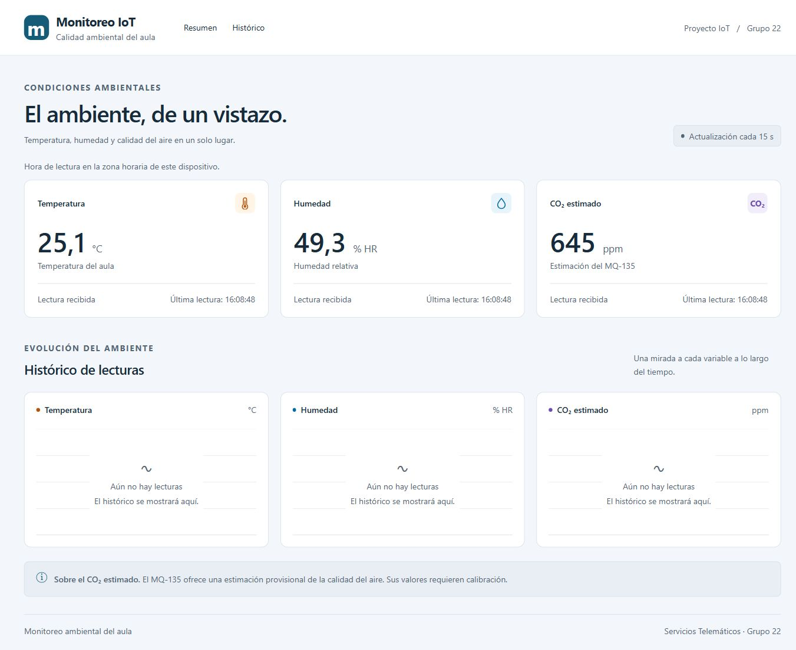
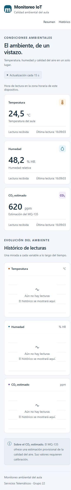
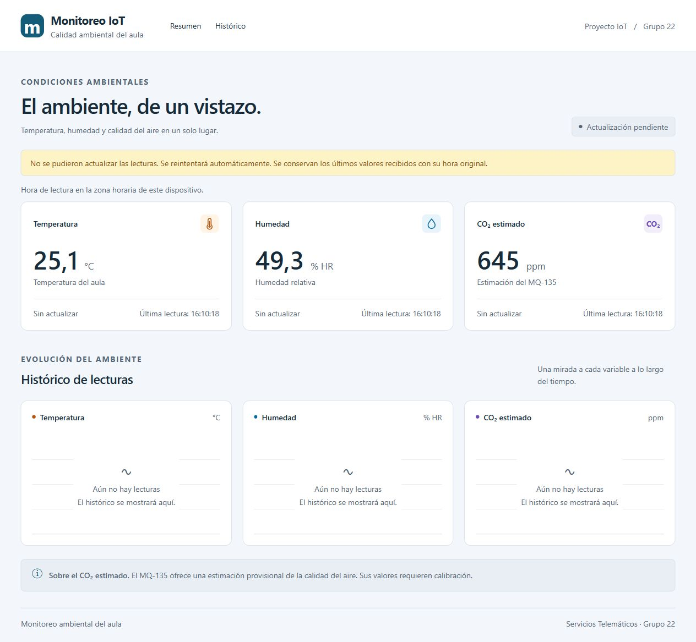

# T-5.4 — Tarjetas de valor actual cada 15 segundos

Issue: #83. Rama: `feat/83-current-value-cards`.

## Resultado y criterios

- [x] Tres tarjetas con valores y unidades °C, % HR y ppm.
- [x] Cada tarjeta muestra la hora de la lectura recibida (`fecha_hora`).
- [x] Consulta inicial y actualización automática cada 15 segundos sin recarga.
- [x] Video corto con actualización visible.

Se reutilizan el cliente #81 y el layout #82. Se implementa exclusivamente la
consulta de valores actuales; el histórico y los indicadores ambientales quedan
para sus tareas. Se preservan los colores, tamaños y tipografía de la revisión
#105. CO₂ sigue identificado como estimado, sin clasificar riesgo.

## Integración comprobada

Se ejecutaron el router, controlador y servicio reales de #76 desde la rama
`feature/backend-mqtt-api`, sin sustituir sus respuestas ni su consulta a
`v_ultima_lectura`. PostgreSQL 15 utiliza el esquema completo del repositorio
en un esquema aislado dentro de una transacción. Se insertaron lotes sintéticos
cada 15 segundos y la UI los leyó mediante HTTP y CORS reales.

No se utilizó ESP32. Los valores de prueba son sintéticos; el backend, la vista,
la base de datos y las peticiones del frontend son reales. No se alteraron los
datos del esquema público. Al detener el servidor de prueba se ejecuta ROLLBACK.

Revisión del backend utilizada: `2b681a7d89d3c0444f42ddccf65b8e5c83d2448e`.

## Evidencia

[Video: frontend + backend + PostgreSQL](actualizacion-backend.mp4).
Secuencia de 32 capturas reales del navegador, aproximadamente una por segundo,
codificadas manteniendo los intervalos observados. No es una grabación continua
a alta frecuencia. Registro: [actualizacion-observada.json](actualizacion-observada.json).

Se observaron las horas UTC `20:08:03.353Z`, `20:08:18.355Z`, `20:08:33.367Z`
y `20:08:48.369Z`, con intervalos de aproximadamente 15 segundos. Las tarjetas
alternaron 24,5 °C / 48,2 % HR / 620 ppm y 25,1 °C / 49,3 % HR / 645 ppm,
sin recargar ni navegar durante la captura.





Después de detener el backend se observó el aviso de error, conservando los
valores y la hora original de la última lectura recibida:



Se confirmó que no quedaron esquemas `qa_cards_%` en PostgreSQL tras la prueba.

## Reproducción de la prueba controlada

1. Usar un checkout separado de la rama de backend con #76, manteniendo las carpetas
   `backend/` y `database/`. Instalar sus dependencias con `pnpm install --frozen-lockfile`
   dentro de `backend/` y configurar su `.env` para PostgreSQL local. El usuario
   necesita poder crear un esquema de prueba en esa base.
2. Copiar `servidor-prueba.ts` de esta evidencia a la raíz de esa carpeta `backend/`
   y ejecutar allí `pnpm exec tsx servidor-prueba.ts`. El script importa el código
   real del backend, crea datos aislados y escucha en `http://127.0.0.1:4400`.
3. En Git Bash, dentro de nuestro `frontend/`, ejecutar:

   ```bash
   VITE_API_URL=http://127.0.0.1:4400/api npm run dev -- --host 127.0.0.1 --port 5176 --strictPort
   ```

4. Abrir `http://127.0.0.1:5176/` y esperar al menos 30 segundos. No recargar.
   Confirmar valores, unidades y cambios en las horas recibidas.
5. Detener ambas terminales con Ctrl+C. El servidor de prueba revierte la transacción.
   Este script no forma parte de la aplicación ni del backend de producción.

## Validación y dependencia de PR

- `npm test`: 20 pruebas (16 del cliente y 4 del polling).
- `npm run lint` y `npm run build`.
- Navegador: tres tarjetas y tres horas a 1366 px y 360 px; sin scroll horizontal.
- Cancelación, timeout, recuperación tras error y listas vacías se comprueban en
  las pruebas automatizadas. Un fallo conserva los datos anteriores en la UI.

El PR #105 de #82 aún estaba abierto al preparar esta entrega. Para que el diff
muestre únicamente #83, el PR se apila sobre `feat/82-dashboard-layout`. Primero
se debe integrar #105; después cambiar el destino a `feature/frontend-dashboard`
y comprobar otra vez el diff y los conflictos. No se fusionó ningún PR ajeno.
