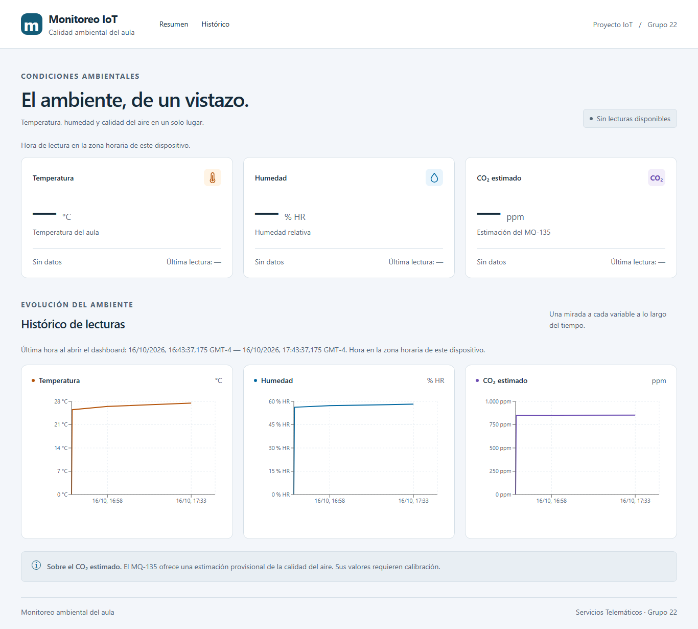
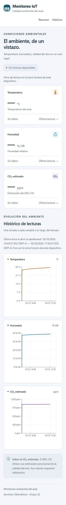

# T-5.5 — Gráficos históricos con Recharts

Issue: #84. Rama: `feat/84-history-charts`.

## Resultado

- Tres gráficos de líneas: temperatura, humedad y CO₂ estimado.
- Eje X con fecha/hora y escala temporal numérica que respeta intervalos irregulares.
- Eje Y con valores y unidades °C, % HR y ppm.
- Tooltip con valor y fecha/hora completa, milisegundos y zona del dispositivo.
- Rango explícito de última hora al abrir, común a las tres consultas.
- Carga, error y ausencia de lecturas independientes por variable.
- Cancelación de peticiones obsoletas y timeout de 10 segundos.

El componente acepta `range={{ desde, hasta }}` para la futura #85. No se
incorporaron selectores ni cambios al backend o al contrato del cliente.

## Capturas

Estas capturas usan el frontend real en Chrome headless con respuestas HTTP
controladas mediante Chrome DevTools Protocol. Los datos son **sintéticos**:
se cubrieron intervalos de 15 segundos, 15 minutos y 50 minutos desde el inicio
del rango, con un valor cero para comprobar que no se interpreta como ausencia.
Las tarjetas actuales recibieron una lista vacía en esta comprobación.
No se utilizó PostgreSQL ni ESP32, ni se modificó el backend.
La aplicación no contiene datos de demostración.





## Validación

Entorno: Node.js 24.22.0, pnpm 10.34.7 y Recharts 3.10.1.

Desde `frontend/`:

```powershell
npm.cmd test
npm.cmd run lint
npm.cmd run build
```

- 30 pruebas aprobadas: 20 existentes y 10 nuevas.
- Lint sin advertencias y build de TypeScript/Vite correcto.
- Pruebas nuevas: solicitudes con el cliente real y fetch simulado, rango
  inicial, errores parciales, listas vacías, cancelación, cambio de rango,
  respuestas tardías, timeout, conservación de lecturas, formatos y componentes.
- Chrome a 1366 y 360 px: tres curvas, etiquetas temporales y unidades visibles,
  sin scroll horizontal y sin excepciones de JavaScript.
- Interacción real de puntero: tooltip de un punto con valor cero y fecha/hora
  completa, incluidos milisegundos y zona GMT.
- Respuestas controladas adicionales: tres listas vacías; error HTTP 500 en
  humedad mientras temperatura está vacía y CO₂ muestra un único punto.

Para repetir manualmente con la API real, configurar `VITE_API_URL` y CORS,
ejecutar `npm.cmd run dev` y usar lecturas dentro de la última hora. Comprobar
la evolución de las tres variables y el tooltip al pasar el puntero por sus
puntos. La revisión completa en dos navegadores corresponde a #87.
