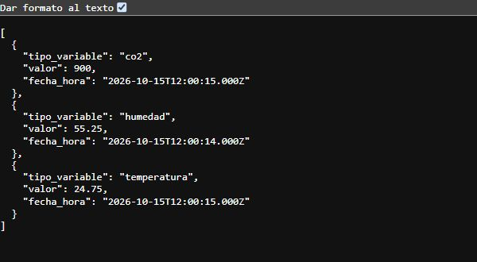

# Últimas lecturas: evidencia de #76

Verificación del 16 de octubre de 2026. Contrato: sección 4 de
[api.md](../api.md). Dependencias: #73 y #27.

## Resultado y criterios de aceptación

| Criterio | Comprobación |
|---|---|
| Última lectura de cada variable con su fecha | Prueba HTTP con PostgreSQL real: seis lecturas insertadas fuera de orden cronológico; devuelve la más reciente de cada variable. |
| Uso de `v_ultima_lectura` | El servicio consulta la vista del SQL versionado, con orden por `tipo_variable ASC`. |
| Formato de `docs/api.md` | Array directo, tres campos, sin `id`, valores numéricos y fechas UTC con milisegundos. |

La captura corresponde a una respuesta real de
`GET http://127.0.0.1:3076/api/lecturas/ultima`, con HTTP 200.
Contiene datos sintéticos de prueba, no mediciones del ESP32.



La base local habitual todavía no tenía la vista instalada. Para la captura
se cargó `database/esquema.sql` sin modificarlo en un esquema separado,
con seis lecturas sintéticas. El backend compilado arrancó con `API_PORT=3076`
y `PGOPTIONS=-c search_path=<esquema_de_prueba>` solo en su proceso.
Después se detuvo y se eliminó ese esquema. Se conservaron los datos habituales.
Una instalación normal requiere el esquema del repositorio, como indica el README.

## Reproducción

Desde `backend/`, con las variables PostgreSQL de `backend/.env`:

```powershell
pnpm install --frozen-lockfile
pnpm test
pnpm run test:integration:latest
pnpm typecheck
pnpm build
```

Resultados: 27 pruebas del backend y 4 comprobaciones de integración aprobadas;
tipos y compilación sin errores. La integración carga el SQL versionado en
una transacción aislada y ejecuta `ROLLBACK` al terminar; no requiere ESP32 ni MQTT.
También comprueba lista vacía, variable ausente, cero y fechas con zona horaria.
Las pruebas HTTP cubren query/cuerpo no admitidos (400), fallo PostgreSQL (500),
valores no finitos y fechas inválidas, sin exponer detalles internos.

Para probar manualmente con el esquema ya instalado, ejecutar `pnpm dev`
y abrir `/api/lecturas/ultima` en el puerto configurado. Sin lecturas debe
devolver `200` con `[]`; una variable ausente se omite. Las lecturas antiguas
se conservan: el aviso de antigüedad corresponde al frontend.
