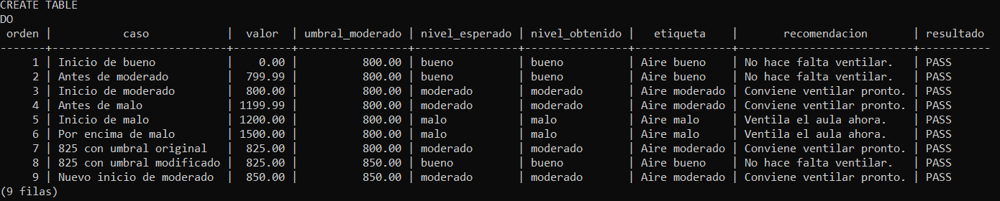
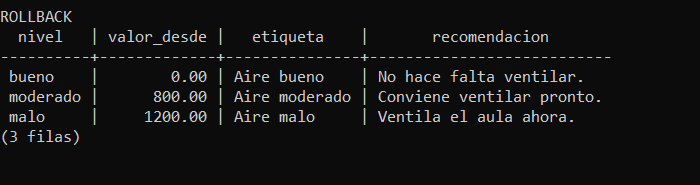

# Verificación de umbrales de CO2 y v_estado_aire — #88

## Alcance

Comprobar la vista del proyecto con lecturas sintéticas y demostrar que
los rangos se configuran desde `umbrales`, sin cambiar código. No es una
medición del sensor ni una validación de la precisión del MQ-135.

Los límites provisionales son: bueno desde 0 hasta menos de 800 ppm,
moderado desde 800 hasta menos de 1200 ppm y malo desde 1200 ppm.
El intervalo incluye decimales: 1199,99 todavía es moderado.

## Revisión con el PO

Alfredo (@alfredoronald) comunicó la aceptación provisional de los rangos
0–<800, 800–<1200 y ≥1200 ppm para implementar y probar el Sprint 2:

> Acepto provisionalmente los rangos 0–<800, 800–<1200 y ≥1200 ppm para
> implementar y probar el Sprint 2. Su aceptación definitiva queda pendiente
> de documentar su justificación y revisar los resultados de la calibración
> de HU-08.

Esta aceptación no constituye una validación definitiva de los límites ni
de la precisión del sensor. Documentar su justificación y revisar los resultados
de HU-08 antes de su aceptación definitiva.

## Procedimiento

1. Usar PostgreSQL 15+ con `database/esquema.sql` cargado, conectado como
   dueño de las tablas (`app`). Preferir una base de prueba sin publicadores.
2. Abrir [`verify_co2_thresholds.sql`](../../database/verify_co2_thresholds.sql)
   en DBeaver y ejecutar **todo el script** (no solo el DO ni los SELECT).
   Alternativamente, desde la raíz:

   ```powershell
   & "C:\Program Files\PostgreSQL\18\bin\psql.exe" -X -U app -h localhost -d monitoreo_ambiental -v ON_ERROR_STOP=1 -f database/verify_co2_thresholds.sql
   ```

3. Comprobar los nueve resultados `PASS`. El script falla con una excepción
   si no coinciden valor, fecha, nivel, etiqueta o recomendación.
4. Verificar que la consulta posterior al `ROLLBACK` muestra otra vez
   `moderado = 800`. Las lecturas sintéticas y cambios de umbrales se revierten;
   el id explícito tampoco consume la secuencia de lecturas.
5. Capturar los resultados de DBeaver o psql y adjuntarlos a la issue/PR o guardar
   la captura en `docs/evidencias/umbrales-co2-88.png`.

El ensayo bloquea escrituras en `lecturas` y `umbrales` durante su transacción
para evitar interferencias. Si no obtiene el bloqueo en 5 segundos, falla.
Si DBeaver deja la transacción abortada por un error, ejecutar `ROLLBACK`.
No ejecutar junto con la ingestión MQTT activa.

## Casos esperados

| Caso | CO2 (ppm) | Inicio de moderado | Nivel esperado |
|---|---:|---:|---|
| Inicio de bueno | 0 | 800 | bueno |
| Antes de moderado | 799,99 | 800 | bueno |
| Inicio de moderado | 800 | 800 | moderado |
| Antes de malo | 1199,99 | 800 | moderado |
| Inicio de malo | 1200 | 800 | malo |
| Por encima de malo | 1500 | 800 | malo |
| Lectura con rango original | 825 | 800 | moderado |
| Misma lectura con rango cambiado | 825 | 850 | bueno |
| Nuevo inicio de moderado | 850 | 850 | moderado |

## Resultado de ejecución

Verificación técnica realizada el 16/10/2026 sobre una instancia temporal de
PostgreSQL 18, en `127.0.0.1:55488`, base `threshold_verification`. Se cargó
`database/esquema.sql` y se ejecutó el script como `threshold_app`, dueño de
las tablas, con `NOSUPERUSER NOCREATEDB NOCREATEROLE NOBYPASSRLS`.
La instancia temporal utiliza datos sintéticos y se detuvo al terminar.
No se modificó la base local configurada en `backend/.env`: su servicio
estaba detenido y esta sesión no tenía permisos para iniciarlo.

| Comprobación ejecutada | Resultado |
|---|---|
| Esquema recién cargado, sin lecturas | Los nueve casos devolvieron `PASS` |
| Repetición con lecturas previas, incluida una fecha futura | Los nueve casos devolvieron `PASS` |
| Lecturas después de `ROLLBACK` | Solo las dos filas previas: CO2=700 y temperatura=24 |
| Secuencia después de la segunda ejecución | `last_value=2`, sin consumo por las pruebas |
| Umbrales después de ambas ejecuciones | bueno=0, moderado=800, malo=1200 |
| Vista deliberadamente incorrecta en la base temporal | Error en caso 3: esperado `moderado`, obtenido `bueno` |

La prueba negativa sustituyó la vista únicamente en la instancia temporal
por una clasificación fija `bueno`. El script terminó con error como se
esperaba; demuestra que consulta y comprueba el comportamiento de la vista,
en lugar de limitarse a imprimir resultados esperados.

Resultado de la consulta de nueve casos (en ambas ejecuciones correctas):

| Orden | CO2 | Inicio de moderado | Esperado | Obtenido | Resultado |
|---:|---:|---:|---|---|---|
| 1 | 0,00 | 800 | bueno | bueno | PASS |
| 2 | 799,99 | 800 | bueno | bueno | PASS |
| 3 | 800,00 | 800 | moderado | moderado | PASS |
| 4 | 1199,99 | 800 | moderado | moderado | PASS |
| 5 | 1200,00 | 800 | malo | malo | PASS |
| 6 | 1500,00 | 800 | malo | malo | PASS |
| 7 | 825,00 | 800 | moderado | moderado | PASS |
| 8 | 825,00 | 850 | bueno | bueno | PASS |
| 9 | 850,00 | 850 | moderado | moderado | PASS |

### Captura de la consulta

#### Nueve casos con PASS



#### Resultado posterior al ROLLBACK



Ambas imágenes son recortes de la [captura completa de la terminal](umbrales-co2-88.png)
tras ejecutar el script con `psql` en la instancia temporal descrita arriba.
Muestran los nueve `PASS` y el umbral moderado restaurado a 800 ppm. No son
capturas de DBeaver ni imágenes reconstruidas con resultados esperados.

## Criterios de aceptación

- [x] Rangos revisados y aceptados provisionalmente para el Sprint 2.
- [x] La vista devuelve el nivel correcto en los casos de prueba.
- [x] Cambiar el umbral modifica el resultado sin tocar código.
- [x] Captura de la consulta adjunta y resultados reales documentados.
