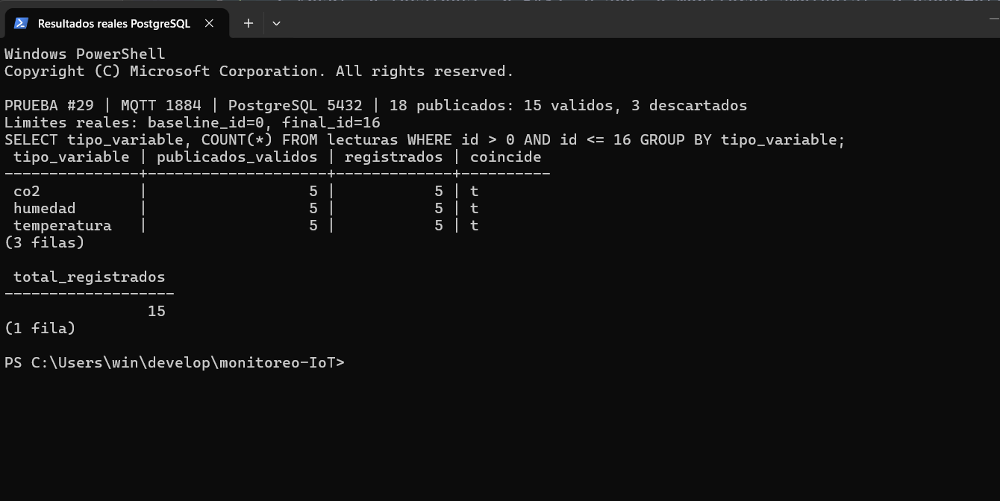
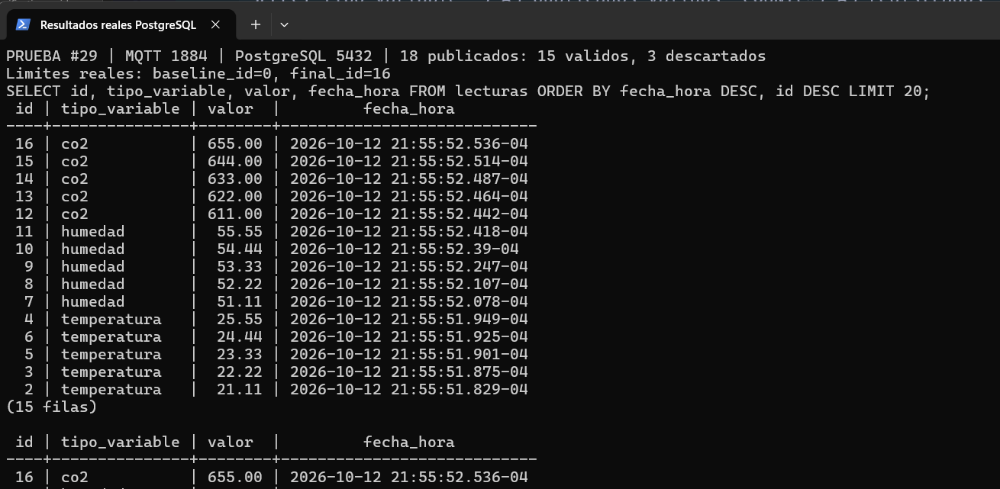

# Verificación del histórico — #29

Dependencia: #28, integrada mediante la PR #63.
Rama: `test/29-verification-queries`. Destino: `feature/backend-mqtt-api`.
Consultas: `database/verification_queries.sql`.

## Preparación

1. Configurar `backend/.env` desde `.env.example` con los valores locales
   de `PG_*` y `MQTT_*`, sin versionar credenciales.
2. Iniciar PostgreSQL, Mosquitto y una única instancia del backend.
3. Desde `backend/`, ejecutar `pnpm install --frozen-lockfile`, `pnpm test`,
   `pnpm typecheck`, `pnpm build` y `pnpm dev`.
4. Confirmar conexión a la base y suscripción a `ambiente/#`.
5. Detener otras publicaciones (incluido el ESP32) durante esta prueba.

## Publicación controlada

Antes de publicar, ejecutar la consulta `limite_id` y anotar el límite inicial.
Publicar con el usuario MQTT `esp32`, QoS 0 y sin `retain`, estos contenidos:

| Topic | Contenidos válidos | Filas esperadas |
|---|---|---:|
| `ambiente/temperatura` | `21.11`, `22.22`, `23.33`, `24.44`, `25.55` | 5 |
| `ambiente/humedad` | `51.11`, `52.22`, `53.33`, `54.44`, `55.55` | 5 |
| `ambiente/co2` | `611`, `622`, `633`, `644`, `655` | 5 |

Publicar también `abc` en `ambiente/humedad`, `1` en `ambiente/status` y
`1013` en `ambiente/presion`: los tres deben descartarse.
Son 18 publicaciones, pero solo 15 lecturas válidas deben guardarse.

Ejemplo en PowerShell (credencial definida solo en la sesión local):

```powershell
& $env:MOSQUITTO_PUB_PATH -h localhost -p 1883 -u esp32 `
  -P $env:MQTT_PUBLISH_PASS -q 0 -t ambiente/temperatura -m 21.11
```

Repetir el comando para cada contenido de la tabla y los tres descartes.
Registrar los envíos que terminaron correctamente. Esperar las inserciones
asíncronas; si faltan filas, revisar el log y los errores de base de datos.
Ejecutar otra vez `limite_id` y anotar el límite final.

## Consultas y evidencia

1. Ejecutar conteo histórico y consultas de últimas lecturas.
2. Sustituir los dos `NULL` de `limits` por los límites de esta ejecución.
3. Ejecutar el conteo controlado: debe mostrar 5 registros y `COINCIDE`
   para cada variable (15 en total).
4. Confirmar que las últimas lecturas tienen los valores publicados.
5. Guardar capturas reales, legibles y sin credenciales:
   `conteo-lecturas-29.png` y `ultimas-lecturas-29.png`, en esta carpeta.

El conteo histórico incluye datos anteriores; solo el intervalo de IDs
permite comparar esta prueba con sus publicaciones. No borrar el histórico.

## Resultados

Verificaciones ejecutadas el 12 de octubre de 2026:

- `pnpm install --frozen-lockfile`: aprobado.
- `pnpm test`: 11 pruebas aprobadas, cero fallos.
- `pnpm typecheck`: aprobado.
- `pnpm build`: aprobado.
- Cambios en `schema.sql` y `esquema.sql`: solo comentarios; SQL sin cambios.

### Prueba real de publicación y persistencia

Ejecutada el 12 de octubre de 2026, aproximadamente a las 21:55:52 (UTC−04:00),
equivalente al 13 de octubre a las 01:55:52 UTC.

- PostgreSQL local: `monitoreo_ambiental`, usuario `app`, puerto **5432**.
- Mosquitto 2.1.2: broker separado en `127.0.0.1:1884`, con autenticación
  y el ACL del repositorio. El servicio instalado ocupaba 1883 y esta sesión
  no podía detenerlo. Para repetir esta ejecución, usar `-p 1884` en el
  ejemplo anterior y `MQTT_URL=mqtt://127.0.0.1:1884` en el entorno local.
- Backend compilado: HTTP 200 en `/`, conectado al broker y a PostgreSQL.
- Publicación mediante `mosquitto_pub`, usuario `esp32`, QoS 0, sin retain.
- Límite inicial: **0**. Límite final: **16**. Se contaron filas, no la
  diferencia de IDs: las secuencias pueden tener huecos y las inserciones
  asíncronas no necesariamente siguen el orden de recepción.

| Variable | Publicados válidos | Registrados | Resultado |
|---|---:|---:|---|
| co2 | 5 | 5 | COINCIDE |
| humedad | 5 | 5 | COINCIDE |
| temperatura | 5 | 5 | COINCIDE |
| **Total** | **15** | **15** | **COINCIDE** |

Se publicaron 18 mensajes: el log registró 18 recepciones y 3 descartes.
Los contenidos `abc`, el estado numérico `1` y el topic de presión no
generaron filas. Se compararon los 15 valores guardados con los publicados
y coincidieron exactamente. Se ejecutaron las cinco consultas del archivo,
sustituyendo los NULL por `0::bigint` y `16::bigint` para esta ejecución.

Últimas lecturas por variable: CO2 **655.00**, humedad **55.55** y
temperatura **25.55**. Las 15 filas permanecen en la base como datos de prueba.

Las siguientes imágenes son capturas reales de PowerShell ejecutando psql,
no representaciones generadas de los resultados:





### Criterios de aceptación

- [x] Consultas guardadas en `database/`.
- [x] Capturas con los resultados de las consultas.
- [x] El conteo coincide con las lecturas válidas publicadas durante la prueba.
